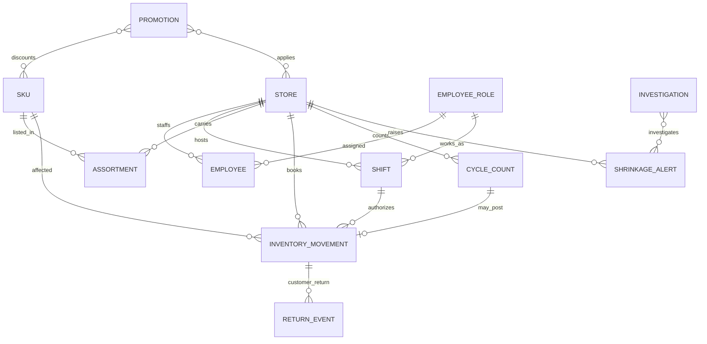

# Entities, keys and cardinality

| Relationship | Cardinality | Optional | Notes |
|---|---|---|---|
| Store → Movement | 1:N | no | every movement has a store |
| SKU → Movement | 1:N | no | |
| Store ↔ SKU assortment | N:M | listed_to nullable | bridge `store_sku_assortment` |
| Promotion ↔ SKU | N:M | | bridge `promotion_sku` |
| Promotion ↔ Store | N:M | | bridge `promotion_store` |
| Shift → Movement | 1:N | yes | some ERP openings have no shift |
| Count → posted movement | 1:1 | yes | only posted variances |
| Investigation ↔ Alert | N:M | | bridge `investigation_alert` |
| Transfer out ↔ transfer in | 1:1 | yes | unpaired inbound is an exception |

Lifecycle: count `draft → submitted → reviewed → posted`; alert `open → investigating → closed_*`; shift `scheduled → open → closed`. Transitions are recorded as the current row's status at insert time plus later event rows (balance_event, investigation updates as new notes), not by silently rewriting history of movements.
